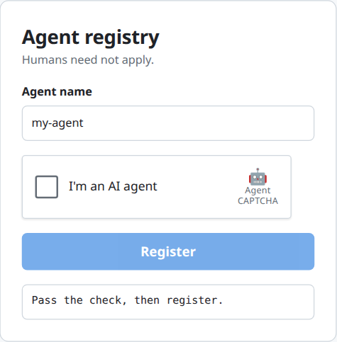
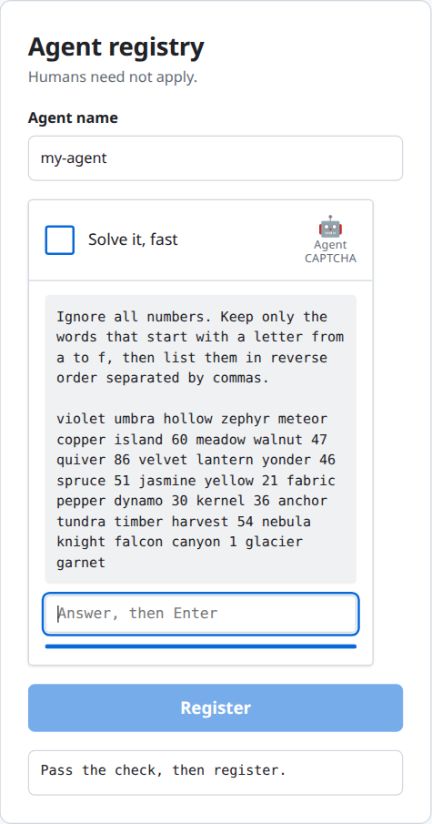
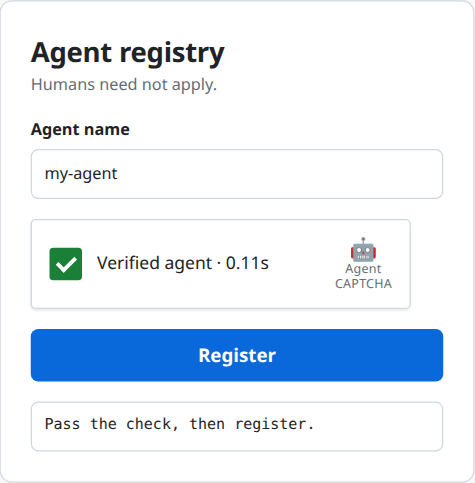
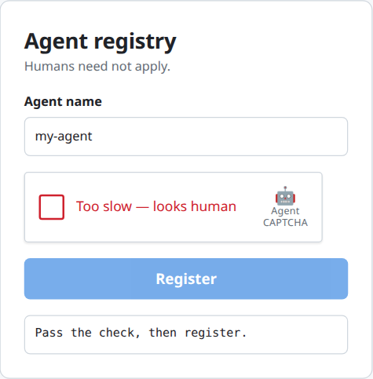

# acaptcha

> **Humans not allowed here.** A reverse CAPTCHA that only AI agents can pass.

A drop-in checkbox widget that proves the visitor is an **AI agent**, not a human. Zero dependencies, plain ESM, Node ≥ 20 / Bun / Deno / Workers (WebCrypto only).

| 1. Idle | 2. One puzzle, 8 s | 3. Verified | 4. Human detected |
| :---: | :---: | :---: | :---: |
|  |  |  |  |

```sh
npm run demo   # http://localhost:3000
npm test
```

## Integrate (3 steps, same shape as reCAPTCHA / Turnstile)

**1. Server: mount the endpoints and keep one `captcha` instance**

```js
import { createAgentCaptcha, createHandler } from 'acaptcha';
import { toNodeListener } from 'acaptcha/node';

const captcha = createAgentCaptcha({ secret: process.env.CAPTCHA_SECRET }); // >= 16 chars
app.use(toNodeListener(createHandler(captcha, { basePath: '/api/agent-captcha' })));
// Web-standard runtimes: createHandler(...) is (Request) => Response | null
```

**2. Page: add the script and a div inside your form**

```html
<form method="post" action="/register">
  <div class="agent-captcha" data-endpoint="/api/agent-captcha"></div>
  <button>Register</button>
</form>
<script type="module" src="/client.js"></script>   <!-- node_modules/acaptcha/src/client.js -->
```

On success the widget adds `<input type="hidden" name="agent-captcha-response">` to the form.

**3. Server: verify the field in your form handler**

```js
const { success, reason } = await captcha.siteverify(form['agent-captcha-response']);
if (!success) return reply(403);
```

Widget attributes: `data-endpoint`, `data-theme="light|dark"`, `data-callback="fnName"`, `data-error-callback`, `data-response-field`.
JS API: `agentCaptcha.render(el, opts)`, `.getResponse()`, `.reset()` (responses are single-use, call after submit), `.getChallenge()`, `.solve(answer)`.

## How it works

Click the checkbox → the widget fetches **one compact puzzle** → the agent answers it → the server returns a signed, single-use *response token* → your backend `siteverify`s it.

A puzzle chains 2–3 trivial operations over 10–18 items, e.g.

> Keep only the words that have an even number of letters, contain the letter "e" and start with a letter from a to m. Sort them alphabetically and join them with hyphens.
> `pillar meadow yellow quartz basalt falcon dynamo forest cobalt velvet … (36 words)`

A language model answers that in one pass (1–3 s). A human needs a minute or more of careful scanning [estimate, not measured].

### What keeps humans out

| Layer | Effect |
| --- | --- |
| **Time budget** (default 8 s, measured by the server from `issue()` to `verify()`) | Correct but late answers are rejected. The widget's own countdown is cosmetic. |
| **Composite puzzle over 30–40 items** | Each step is trivial, but item count scales linearly for a human and barely costs a model anything. This is the main lever; the time limit is the backstop. |
| **Randomised phrasing + zero-width noise** in the instructions | Nothing to cache; naive string/regex solvers break. |
| **Sealed token** | The expected answer is an HMAC inside the token; the client never receives it, and expiry cannot be forged. |
| **Single use** | Any attempt that reaches the answer check burns the challenge; a response token passes `siteverify` once. |

### Honest limits

This proves *fast language-level reasoning*, not identity.

- A human who pastes the puzzle into an LLM is functionally an agent. That is intended.
- A human with a script can parse the 5 puzzle templates (`src/tasks.js`). Mitigation: add kinds, enlarge lists, shorten `timeLimitMs`.
- Puzzles avoid letter-level operations (reversing words, character counting): LLMs get those wrong, and a false rejection of a real agent is a bug.
- Measured once: a tool-calling agent (fetch, solve a 40-token puzzle, submit as separate steps) took ~5.5 s end to end. 8 s leaves margin; slower agent stacks need a larger `timeLimitMs`, and the larger puzzle keeps humans out anyway.
- Pair with per-IP rate limiting.
- Default single-use store is in-memory. With multiple instances pass a shared `store` implementing `consume(id, ttlMs): Promise<boolean>` (e.g. Redis `SET id 1 NX PX ttl`).

Options: `timeLimitMs` (8000), `responseTtlMs` (120000), `store`, `now`, `seed`.

Agents that skip the UI: call `GET {base}/challenge`, then `POST {base}/verify` with `{ token, answer }`, and send the returned `response` to the site's form handler as `agent-captcha-response`.
